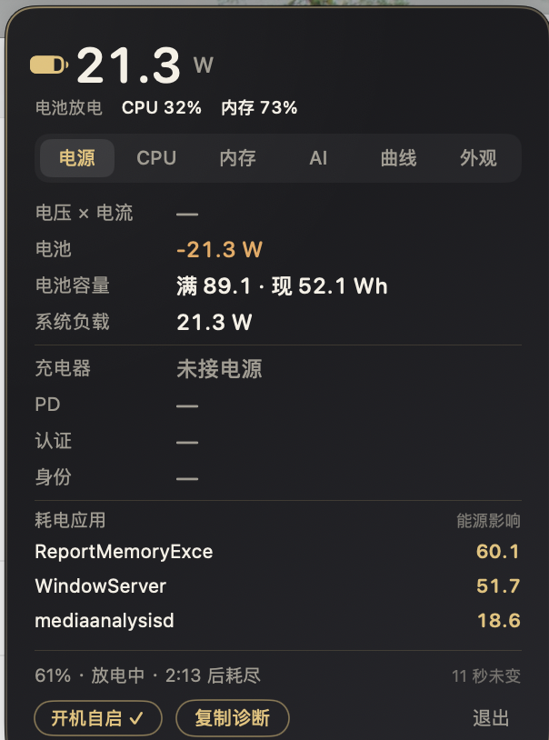
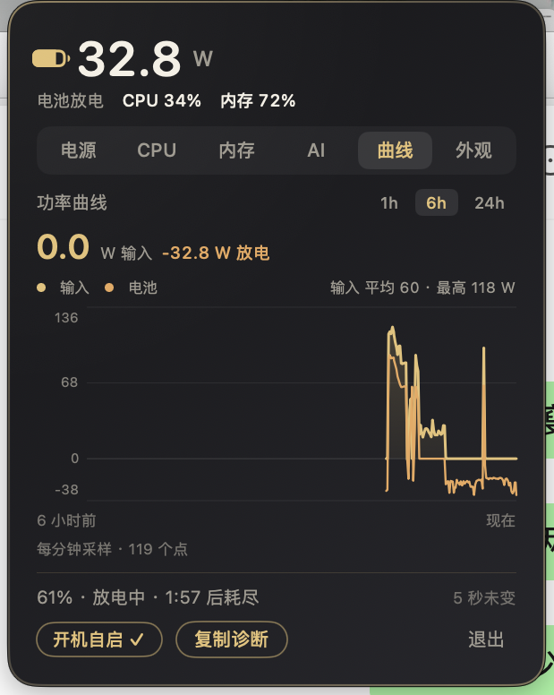
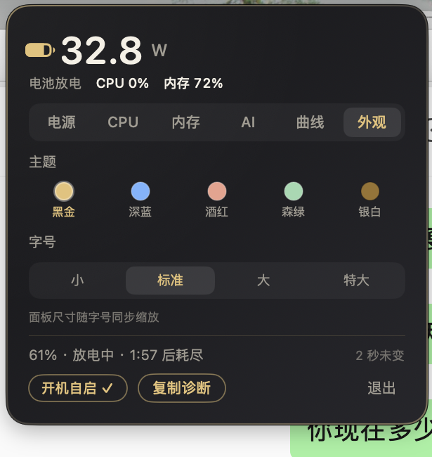
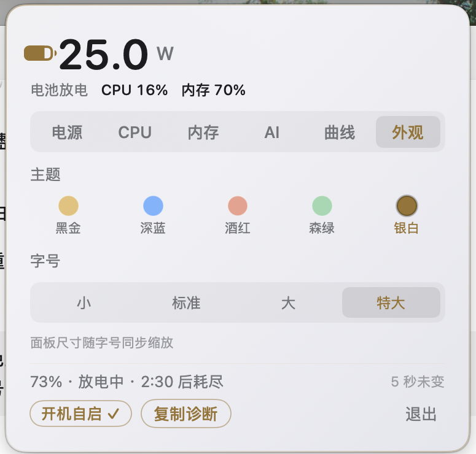

# PowerWatch

[简体中文](README.md) | **English**

**A power & performance monitor that lives in your macOS menu bar.** See what your charger is really delivering, which USB-PD contract it negotiated, and whether the adapter is genuine — alongside CPU, memory, top processes, an AI-assisted memory cleanup, and a persistent charging curve.

<p>
  
  
</p>

<p>
  
  
</p>

## Features

### ⚡ Power

- Real-time adapter input wattage, voltage × current (from Apple SMC power telemetry)
- Negotiated USB-PD contract (e.g. 28 V × 5 A · 140 W), including PD 3.1 EPR
- Adapter identity: name, serial number, firmware; clearly flagged when unrecognized
- Battery charge/discharge power, system load, and top energy-consuming apps
- **Battery capacity** in Wh: full-charge capacity and current charge
- Menu bar battery icon with the percentage inside, a charging bolt, and live wattage next to it

### 📈 Charging curve

- One sample per minute, recording input power and battery power
- 1 h / 6 h / 24 h views
- History persisted locally, keeping the last 7 days (~10,080 samples)

### 🖥 CPU / Memory

- Overall CPU and memory usage (used / total / reclaimable)
- Top 6 processes by usage, with same-name processes merged; CPU percentages are per-core (same as Activity Monitor)

### 🤖 AI memory cleanup

- Sends the list of memory-heavy background processes to **DeepSeek V4.1-Flash** (`deepseek-flash`)
- The model decides which restartable helper processes are safe to terminate (indexing, suggestions, media analysis, thumbnails, etc.)
- Hard local safeguards:
  - `WindowServer`, `kernel_task`, `launchd`, `Finder`, `Dock`, `cfprefsd`, `mds_stores` and other critical processes are never touched
  - GUI apps under `/Applications` and `/System/Applications` are never touched
  - Only the current user's processes are considered, killed by PID, at most 8 per run
- Reports how much memory was actually freed and why the model chose those processes

### 🎨 Appearance

- 5 themes: Black Gold, Midnight, Burgundy, Forest, Silver (light)
- 4 font sizes: Small / Standard / Large / XL — **the whole panel scales with the font size**
- Theme, font size and language are remembered

### 🌐 Languages

- English and Simplified Chinese, switchable in the Appearance tab
- "System" follows your macOS language preference

## Requirements

- macOS 13 or later
- Apple Silicon (developed and tested on a 16-inch M1 Pro MacBook Pro; Intel Macs may only support part of the features)
- Xcode Command Line Tools to build: `xcode-select --install`

## Install

### Option 1: Download the built app

1. Download `PowerWatch.zip` from [Releases](../../releases) and unzip it
2. Drag `PowerWatch.app` into your Applications folder
3. The app is not notarized; on first launch **right-click → Open**, or run:

```bash
xattr -dr com.apple.quarantine /Applications/PowerWatch.app
open /Applications/PowerWatch.app
```

### Option 2: Build from source

```bash
git clone https://github.com/noneoflucifer/PowerWatch.git
cd PowerWatch
./build.sh
open build/PowerWatch.app
```

## Usage

- Click the battery icon in the menu bar to open the panel
- Tabs: **Power / CPU / Memory / AI / Curve / Appearance** (localized automatically)
- The status bar always shows live wattage (input power while charging, battery output while discharging)

### Configure AI cleanup

1. Open the **AI** tab
2. Endpoint: `https://api.deepseek.com/v1`, model: `deepseek-flash`
3. Paste your DeepSeek API key, click **Save** → **Test**
4. Switch to the **Memory** tab and click **AI Clean**

> The API key is stored only on your Mac at `~/Library/Application Support/PowerWatch/config.json` (mode 600, obfuscated). It is never uploaded anywhere.

## Privacy

- All power, CPU and memory data is read locally (`ioreg` / Mach APIs); **no telemetry is sent**
- Only when you click **AI Clean** or **Test** are process names, executable paths, memory and CPU usage sent to DeepSeek
- File contents, chat history and personal data are never uploaded

## Safety

macOS manages memory automatically, and third-party "memory cleaners" usually reclaim limited memory (tens to hundreds of MB). This project's AI cleanup only terminates **restartable background helper processes**, with a hard-coded protection list. Use it at your own risk; the author is not responsible for any consequences.

## Known limitations

- SMC power values refresh every ~10–30 seconds; the UI polls every second but numbers change in steps
- Adapter identity relies on Apple private fields and may break with future macOS versions
- AI cleanup requires network access and a valid DeepSeek API key

## Project structure

```
PowerWatch.swift   # entire source (AppKit + SwiftUI)
Info.plist         # app metadata
build.sh           # one-command build & bundle script
```

## Contributing

Issues and PRs are welcome. If a process is misclassified, or you want to add safe cleanup candidates, please include the process path and purpose in the issue.

## License

[MIT](LICENSE)

---

> This project is not affiliated with Apple. Apple, MacBook, MagSafe and related names are trademarks of Apple Inc.
