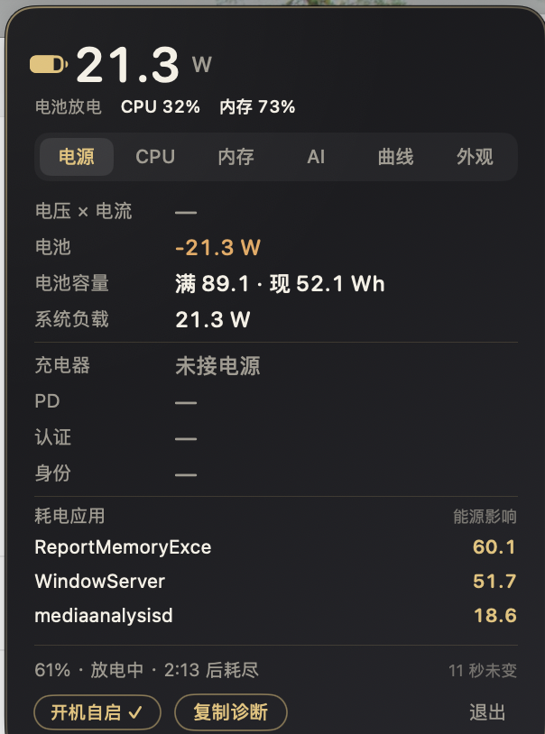
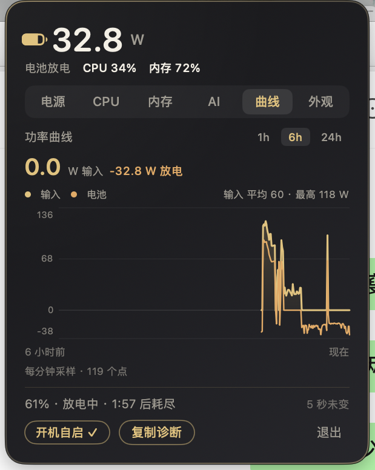
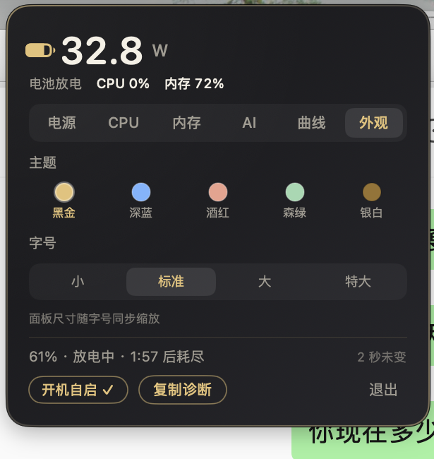
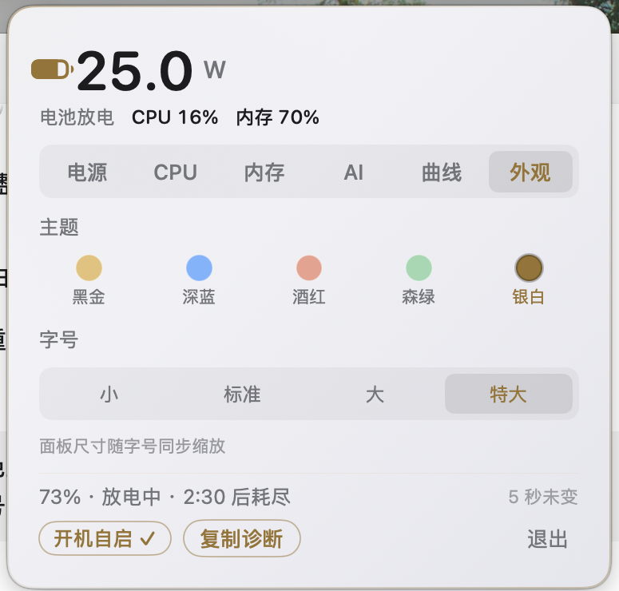

# WattBar

**简体中文** | [English](README.en.md)

**macOS 菜单栏里的电源与性能监视器。** 看充电器真实功率、PD 档位和适配器身份，也看 CPU / 内存和进程排行；还能用 DeepSeek 分析内存占用，安全清理可回收的后台进程。

<p>
  
  
</p>

<p>
  
  
</p>

## 功能

### ⚡ 电源

- 实时显示适配器输入功率、电压 × 电流（数据来自 Apple SMC 电源遥测）
- PD 协商档位（如 28 V × 5 A · 140 W），支持 USB PD 3.1 EPR
- 识别充电器身份：名称、序列号、固件版本；未识别时明确标注
- 电池充电 / 放电功率、系统负载、耗电应用排行（energy impact）
- **电池容量**：满电最大容量与实际电量（Wh），按当前电压换算
- 菜单栏电池图标内嵌电量百分比，充电时显示闪电，旁边实时显示瓦数

### 📈 充电曲线

- 每分钟采样一次，记录输入功率与电池功率
- 支持 1 小时 / 6 小时 / 24 小时视图
- 历史数据本地持久化，保留最近 7 天（约 10080 个采样点）

### 🖥 CPU / 内存

- 整机 CPU 占用、内存占用（已用 / 总量 / 可回收）
- 按占用排序的进程 Top 6，同名进程自动合并；CPU 百分比为单核口径（与活动监视器一致）

### 🤖 AI 内存清理

- 把内存占用较高的后台进程列表交给 **DeepSeek V4.1-Flash**（`deepseek-flash`）分析
- 由模型判断哪些是可安全终止、会自动重启的辅助进程（索引、建议、媒体分析、缩略图服务等）
- 本地硬性保护：
  - `WindowServer`、`kernel_task`、`launchd`、`Finder`、`Dock`、`cfprefsd`、`mds_stores` 等关键进程永不触碰
  - `/Applications` 与 `/System/Applications` 下的 GUI 应用永不触碰
  - 只处理当前用户的进程，按 PID 精确终止，单次最多 8 个
- 清理后显示实际释放的内存与 AI 给出的理由

### 🎨 外观

- 5 套主题：黑金、深蓝、酒红、森绿、银白（浅色）
- 4 档字号：小 / 标准 / 大 / 特大，**面板尺寸随字号同步缩放**
- 主题与字号选择会被记住

## 系统要求

- macOS 13 或更新版本
- Apple Silicon（在 M1 Pro 16 英寸 MacBook Pro 上开发与测试；Intel 机型可能只能使用部分功能）
- 编译需要 Xcode Command Line Tools：`xcode-select --install`

## 安装

### 方式一：下载构建好的 App

1. 从 [Releases](../../releases) 下载 `WattBar.zip` 并解压
2. 把 `WattBar.app` 拖进「应用程序」
3. 因为未做 Apple 公证，首次打开请 **右键 → 打开**，或在终端执行：

```bash
xattr -dr com.apple.quarantine /Applications/WattBar.app
open /Applications/WattBar.app
```

### 方式二：从源码编译

```bash
git clone https://github.com/noneoflucifer/WattBar.git
cd WattBar
./build.sh
open build/WattBar.app
```

## 使用

- 点击菜单栏的电池图标打开面板
- 顶部标签页：**电源 / CPU / 内存 / AI / 曲线 / 外观**
- 状态栏始终显示实时瓦数（充电为输入功率，放电为电池输出功率）

### 配置 AI 清理

1. 打开「AI」页
2. 接口填 `https://api.deepseek.com/v1`，模型填 `deepseek-flash`
3. 填入你的 DeepSeek API Key，点「保存」→「测试连接」
4. 切到「内存」页，点「AI 清理」

> API Key 只保存在本机 `~/Library/Application Support/WattBar/config.json`（权限 600，做了混淆编码），不会上传到任何地方。

## 隐私

- 所有电源、CPU、内存数据均在本机读取（`ioreg` / Mach 接口），**不发送任何遥测**
- 只有在你主动点击「AI 清理」或「测试连接」时，才会向 DeepSeek 发送进程名、可执行文件路径、内存与 CPU 占用
- 不会上传文件内容、聊天记录或任何个人数据

## 安全说明

macOS 的内存管理由系统自动完成，第三方「清理内存」的收益通常有限（几十到几百 MB）。本项目的 AI 清理只终止**可自动重启的后台辅助进程**，并带有硬编码保护名单；即便如此，仍建议在了解风险的前提下使用，作者不对由此产生的任何问题负责。

## 已知限制

- SMC 电源数据本身约 10–30 秒更新一次，界面每秒读取但数值会呈阶梯变化
- 适配器身份识别依赖 Apple 私有字段，macOS 版本变化可能导致字段不可用
- AI 清理需要网络与有效的 DeepSeek API Key

## 项目结构

```
WattBar.swift   # 全部源码（AppKit + SwiftUI）
Info.plist         # App 元数据
build.sh           # 一键编译打包脚本
```

## 贡献

欢迎提 Issue 或 PR。如果你发现某些进程被误判、或希望增加新的安全清理候选，请在 Issue 中附上进程路径与用途。

## License

[MIT](LICENSE)

---

> 本项目与 Apple 无关。Apple、MacBook、MagSafe 等名称与商标归 Apple Inc. 所有。

## English

**WattBar** is a lightweight macOS menu bar monitor: real charger wattage, USB-PD contract, adapter identity, battery capacity in Wh, CPU/memory usage with top processes, AI-assisted memory cleanup via DeepSeek, and a persistent charging curve with 1h/6h/24h views. Five themes, four font sizes, all local by default.

Build with `./build.sh` (requires Xcode Command Line Tools), then `open build/WattBar.app`.
